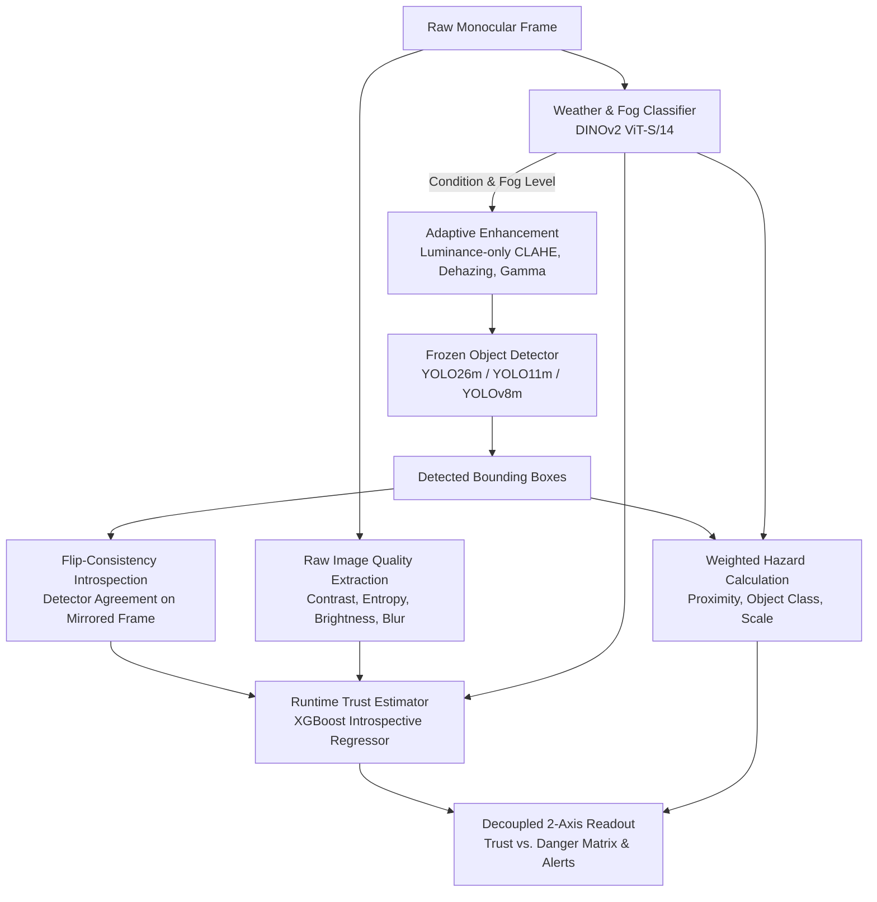

# Confidence-Aware, Weather-Adaptive Hazard Detection for Monocular Driving Video

[](https://www.python.org/)
[](https://pytorch.org/)
[](https://github.com/)
[](LICENSE)
[-purple.svg)](#citation)
[](tests/)

An end-to-end perception pipeline for monocular dashcam and driving video that answers **two fundamental questions separately** for every frame:

| Metric | Core Question | Runtime Mechanism |
|---|---|---|
| **Trust** | *How far can the detector's output be believed right now?* | Lightweight gradient-boosted introspective model predicting detector failure from signals available at runtime (**zero ground truth required**) |
| **Danger** | *How hazardous is the scene, given what was detected?* | Weighted, normalized hazard formulation over detected bounding boxes and proximity, conditioned on weather severity |

---

### Why Keep Trust and Danger Decoupled?

Most conventional perception pipelines fuse confidence and hazard into a single unified risk score. In safety-critical driving, **this conceals the most catastrophic failure mode**:

> **The Empty Road in Dense Fog:**  
> If dense fog prevents the detector from seeing upcoming obstacles, the detector outputs zero boxes. A fused score registers this as **zero danger**.  
> In reality, the scene has **low apparent danger** combined with **critically low trust**.  
> 
> By decoupling the two into a 2-axis readout (**Trust $\times$ Apparent Danger**), the system explicitly flags the dangerous bottom-left quadrant: *"Low trust, low apparent hazard — proceed with caution."*

```
                         TRUST (Runtime Introspection)
                               HIGH ^
                                    |
          Normal Driving            |   Imminent Hazard
          (Safe, Reliable)          |   (Brake / Avoid)
     -------------------------------+-------------------------------> DANGER
          CRITICAL BLINDSPOT        |   Degraded Sensor
          (Empty road in fog;       |   (Adverse conditions with
           undetected hazards)      |    unreliable detections)
                                LOW |
```

---

## System Architecture



*Note: Image-quality features for trust estimation are strictly extracted from the **raw** frame prior to enhancement to prevent synthetic artifacts from corrupting failure prediction.*

---

## Key Empirical Findings

Evaluated across multiple public benchmark datasets (**BDD100K**, **ACDC**, **Cityscapes**, and **DAWN**). All heavy feature backbones are frozen; the only trained components are the weather classifier head and the introspective trust model.

* **Introspective Trust Generalization**:  
  Trained on **clear-day driving footage only**, the trust model outperforms the raw mean-confidence baseline across **all 21 held-out adverse weather strata**:
  - **AUROC 0.73 – 0.76** on unseen weather under the same camera (BDD100K).
  - **AUROC 0.64 – 0.66** under complete cross-dataset / cross-camera shift (ACDC).
  - **AUROC 0.73 – 0.74** on synthetic physical fog (Cityscapes-Foggy).
  - Filtering to act only on the upper 50% most-trusted frames **cuts downstream detector failure rate from 36.8% to 19.7%**.

* **Danger Gap in Adverse Conditions**:  
  The gap between ground-truth hazard and detected hazard ($\Delta_{\text{danger}} = R_{\text{true}} - R_{\text{det}}$) is strictly positive across all adverse conditions, peaking at night (36% to 46% of night frames underestimated by $>0.10$).

* **Adaptive Image Enhancement**:  
  Yields **+5.0 to +7.0 points of pedestrian recall at night** and **+4.0 points in dense fog**, while remaining neutral in rain/snow without introducing false-positive confidence inflation.

* **Real-Time Efficiency (RTX 5060 Laptop GPU)**:
  - **Accurate Mode (Full Pipeline)**: 20.6 FPS at 720p ($p95 = 71\text{ ms}$, Peak VRAM: 439 MB).
  - **Fast Preset**: 34.8 FPS at 720p.

---

## Interactive Showcase

### 1. One-Click Desktop GUI
Launch the complete interactive desktop interface (built with standard Python Tkinter, zero extra frontend dependencies):

```powershell
# Double-click run_gui.bat, or run:
run_gui.bat
```

The GUI provides real-time controls for:
- Video file or live webcam feed selection.
- Architecture toggles (YOLO26m vs. YOLO11m vs. YOLOv8m).
- Adaptive enhancement toggle (observe before/after impact in real-time).
- Execution presets (Fast vs. Accurate).
- Live telemetry stream with visual quadrant mapping.

### 2. Command-Line Execution

**Process Driving Video:**
```powershell
python src_core\app.py video --input results\core\sample_input.mp4 --output results\core\demo_output.mp4 --csv results\core\telemetry.csv --show
```

**Live Webcam Stream:**
```powershell
python src_core\app.py camera --device cuda
```

*Common Options:*
- `--device cpu|cuda` : Target device (CPU supported with low latency presets).
- `--no-enhance` : Evaluate raw detector performance with enhancement disabled.
- `--no-dino` : Ultra-fast mode bypassing vision transformer features.
- `--weather-every N` : Cache weather condition every $N$ frames to maximize FPS.

---

## Quickstart & Installation

### Environment Setup
Requires Python 3.10+ (tested on Python 3.12, Windows 11 & Linux).

```powershell
# 1. Clone repository
git clone https://github.com/<your-username>/<repo-name>.git
cd <repo-name>

# 2. Create virtual environment
python -m venv .venv
.\.venv\Scripts\Activate.ps1    # On Linux: source .venv/bin/activate

# 3. Install PyTorch (Choose GPU or CPU)
# NVIDIA GPU (CUDA 12.8):
pip install torch torchvision --index-url https://download.pytorch.org/whl/cu128
# CPU only:
# pip install torch torchvision --index-url https://download.pytorch.org/whl/cpu

# 4. Install pipeline dependencies
pip install -r requirements.txt
```

### Running Test Suite
Verify pipeline integrity via the automated test suite (38 unit & regression tests):
```powershell
pip install -r requirements-dev.txt
python -m pytest tests -q
```

---

## Repository Structure

```
├── src_core/               # Core perception pipeline & application
│   ├── app.py              # CLI runner for video and live camera feeds
│   ├── gui.py              # Desktop graphical interface
│   ├── detector.py         # YOLO detector abstraction & flip-consistency
│   ├── enhancement.py      # Weather-conditioned luminance enhancement
│   ├── trust.py            # Introspective XGBoost trust model & feature extractors
│   ├── danger.py           # Multi-class spatial hazard calculation
│   └── run_experiments.py  # Benchmark & evaluation drivers
├── src_v4/                 # Weather & fog severity classifier (DINOv2)
├── src/, src_cityscapes/   # Baseline model architectures
├── tests/                  # Pytest test suite (38 tests)
├── results/                # Quantitative evaluation results & metrics
│   ├── core/               # Tabular metrics, benchmark results, sample video
│   └── weather_v4/         # Weather confusion matrices & DINOv2 weights
├── requirements.txt        # Pinned runtime dependencies
├── run_gui.bat             # 1-click launcher for Windows
└── LICENSE                 # PolyForm Noncommercial 1.0.0
```

---

## Research Status & Paper

> **Preprint / Paper in Preparation (2026)**  
> The comprehensive paper detailing the experimental analysis, leave-one-camera-out ablations, and theoretical bounds of the decoupled trust formulation is currently in preparation.

### Citation
If you reference this work, utilize the codebase for non-commercial research, or build upon the findings, please cite:

```bibtex
@article{arsalan2026confidence,
  title={Confidence-Aware, Weather-Adaptive Hazard Detection for Monocular Driving Video},
  author={Arsalan, Syed},
  journal={Preprint in preparation},
  year={2026},
  url={https://github.com/<your-username>/<repo-name>}
}
```

---

## License & Inquiries

This project is licensed under the **PolyForm Noncommercial License 1.0.0** (see [LICENSE](LICENSE)).

- **Permitted**: Academic study, peer review, educational coursework, benchmarking, and portfolio review for recruitment.
- **Prohibited**: Commercial exploitation, sales, proprietary integration, or patenting without an explicit commercial license.
- **Commercial & Research Inquiries**: For commercial licensing, enterprise deployment, or academic inquiries, please contact **Syed Arsalan** via GitHub profile.
